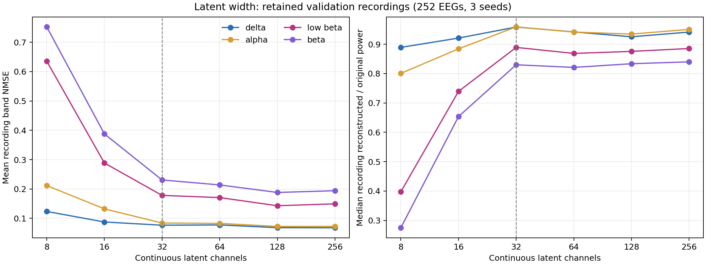

#empircal_study 
#notes 
#EEG

This experiment was motivated by recent trend of scaling up EEG foundation model with increasing latent dimension. From [LaBraM's](https://github.com/935963004/LaBraM)  200 dimension to [REVE's](https://arxiv.org/abs/2510.21585) 512 dimension, however the real word improvements for different downstream task seems small (REVE is slightly better in most categories, but they also trained on 30x more data). This rises the question how much does scaling help and how much information can we extract from scalp EEGs.  

An [empirical study](https://www.mdpi.com/1424-8220/23/8/4112) evaluated shallow autoencoders dimension tradeoff for clinical classification, and reported an 8:1 compression ratio with minimal information loss. Since the author relied on zero-shot classification performance as a proxy for information retention metric, the results might not be generalizable. Here we take a more direct approach, measuring rate-distortion trade-off with latent quantization directly. 

## Experimental design

The experiments used 6-minutes  20-channel resting EEG recording from 2,560 participants for training, 252 validation participants. Each recording was segmented into deterministic 8-second windows and sampled randomly during training. 

We designed two models with the same architecture, a continuous autoencoder to evaluate latent dimension and a quantized bitrate autoencoder for rate-distortion curve.

The continuous AE were trained at latent widths 8, 16, 32, 64, 128, and 256. It does not use quantizer or entropy prior. Three training seeds (0, 24, 48) were run per width for 50 epochs, giving 18 fitted models. Training and checkpoint choice used normalized waveform NMSE. 
The bitrate AE used a 64-channel quantized bottleneck with a learned entropy prior. They were trained for 30 epochs using normalized waveform MSE/NMSE plus λ times estimated bit rate. The bit rate is measured as `−log₂ p(ẑ)` divided by original `channel * sample rate`, not an actual entropy-coded file size. 

Band-limited NMSE was used to evaluate reconstruction quality at each canonical frequency band. It was calculated as waveform squared error divided by original signal energy after Hann tapering and FFT filtering. Bands are delta 1–4 Hz, alpha 8–13 Hz, low beta 13–20 Hz, and whole beta 13–30 Hz, with upper endpoints excluded. A value of 1 is the zero-output reference.

## Continuous latent-width results

A 32-channel bottleneck (or 10:1 compression ratio) achieves the best tradeoff between compression and waveform fidelity.  Width 128 gives the smallest mean recording NMSE on most bands, but gains over width 32 are modest relative to the changes below 32. The results is similar to the study conducted by [Khan et al.](https://www.mdpi.com/1424-8220/23/8/4112)

The largest adjacent degradation appears when shrinking width occurs at 16 $\rightarrow$ 8, especially for beta rhythm. On the other hand, delta rhythm is already well preserved at width of 8, with little benefit from increased latent capacity. This supports loss of faster activity at the smallest width. The larger reconstruction error in low beta suggests a stronger capacity requirement for preserving faster activity in this model.

*Figure guide:*  Wider latent provides comparatively modest additional improvements. Left panel: Mean recording band NMSE. Right panel: median reconstructed-to-original band power ratio. 

## Quantized bitrate results

In the bitrate experiment, achieved rate falls from 0.796 to 0.202 estimated bits/channel-sample as λ rises from 0.01 to 1.00. From λ = 0.01 to 0.05, estimated rate falls by 42%, while band-pooled waveform NMSE increases by 0.009. From λ = 0.50 to 1.00, bit rate falls only about 16%, while waveform NMSE increases about 0.033. These differences suggest diminishing savings at the low-bitrate end. The bitrate limitation imposes a higher penalty in beta fidelity, suggesting the limitation of optimizing waveform MSE.   

*Figure guide:*  Loss of faster waveform detail under compression. Left panel: the achieved compression–quality tradeoff. Each point shows a model’s reconstruction error within the indicated frequency band. Right panel: the effect of the training penalty. $\lambda$  controls how strongly training penalizes bitrate. 

## Conclusion

The two empirical experiments show a consistent result: lower latent capacity preferentially worsens faster band reconstruction. In the latent sweep, the latent validation curve improves substantially from 8 to 16 channels, then more gradually through 128. In the bitrate sweep, distortion grows faster with increasing frequency, with beta activity deteriorating much faster than delta or alpha. Alpha band is reconstructed better than delta at highest bitrate in our experiment, but that crossover is small and depends on the EEG samples. The experiment therefore does not identify alpha band is more regular and compressible.

The results suggest that most of the EEG waveform is predictable or redundant (with >90% compression ratio), while some faster activity requires substantially more capacity to reconstruct accurately. Furthermore, overall reconstruction error can hide information loss at higher frequency band while incentivize model to focus on low information canonical bands. This cautions against using waveform L1/L2 reconstruction error for pretraining training. 